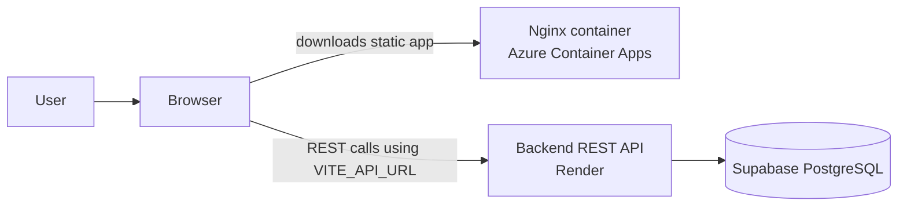
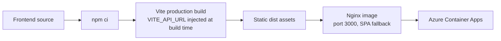

# Frontend Architecture

## Purpose and runtime boundary

The frontend is a React and TypeScript single-page application built with Vite. It presents event discovery and details, organization workspaces and membership, authentication and profile screens, and participant task views. It calls the backend REST API directly using the configured API base URL.

```text
Browser -> Nginx static site (Azure Container Apps) -> REST API (Render)
```



The browser owns presentation and interaction state. Backend business rules and persistence remain on the backend. API requests are grouped by feature or shared API concern; shared query and token helpers support those requests.

## Source structure

| Path | Responsibility |
| --- | --- |
| `src/main.tsx` | Browser entry point and application bootstrap. |
| `src/App.tsx` | Route and application-level composition. |
| `src/features/` | Feature screens, feature API functions, validation, and types. Current areas include `auth`, `events`, `organizations`, `profile`, `tasks`, and `errors`. |
| `src/shared/api/` | Shared API client, API types, and common authentication/organization calls. |
| `src/shared/lib/` | Shared environment, query client, token storage, and formatting/status helpers. |
| `src/shared/ui/` | Reusable UI components and layout primitives. |
| `src/styles/` | Global CSS. |
| `public/` | Static assets copied to the production output. |
| `cypress.config.ts` | Cypress end-to-end runner configuration. |

Feature-specific components and API code should remain with the feature; reusable cross-feature pieces belong in `shared`.

## Configuration

Vite configuration is in `vite.config.ts`; TypeScript settings are in `tsconfig.json`, lint rules in `eslint.config.js`, and Cypress settings in `cypress.config.ts`. The Vite development server binds to `0.0.0.0:3000` with a strict port. Cypress currently uses `http://127.0.0.1:5173` as its base URL, so the checked-in Vite and Cypress port settings do not match and should be reconciled before relying on the end-to-end command.

`VITE_API_URL` is the frontend API base URL. It is a Vite build-time variable and is compiled into browser assets; it must contain a public endpoint and must never contain a secret. Local development uses `.env.example` as a template for an ignored `.env` file. There is no development API proxy configured.

The package requires Node.js 22.12+ in the 22.x line, 24.x, or 26+, and npm 10+. Available scripts include `npm run dev`, `npm run build`, `npm run lint`, `npm run typecheck`, and Cypress open/run commands.

## Production build and deployment

The root `Dockerfile` builds in two stages. A Node 22 Alpine image installs locked dependencies with `npm ci` and runs the TypeScript/Vite production build. The `VITE_API_URL` Docker build argument is required for that build. The resulting static `dist` output is copied into an Nginx Alpine image.

`nginx.conf` serves the static files on port `3000` and routes unknown paths to `index.html`, enabling client-side route fallback. The production frontend is hosted on Microsoft Azure Container Apps. Supply the correct `VITE_API_URL` at image build time for each environment; changing the service environment after the assets are built does not rewrite that value in the bundle.



## Quality checks

Use the repository scripts for build, lint, TypeScript checking, and Cypress end-to-end checks. Cypress expects the application to be available at its configured base URL. The README contains the developer setup and command list.

## Operational limits

This file reflects the checked-in frontend and its README. Azure resource definitions and deployment pipeline details are not present in the repository; the hosting configuration is managed outside it. API contract details belong to the backend OpenAPI document and maintained project documentation.
